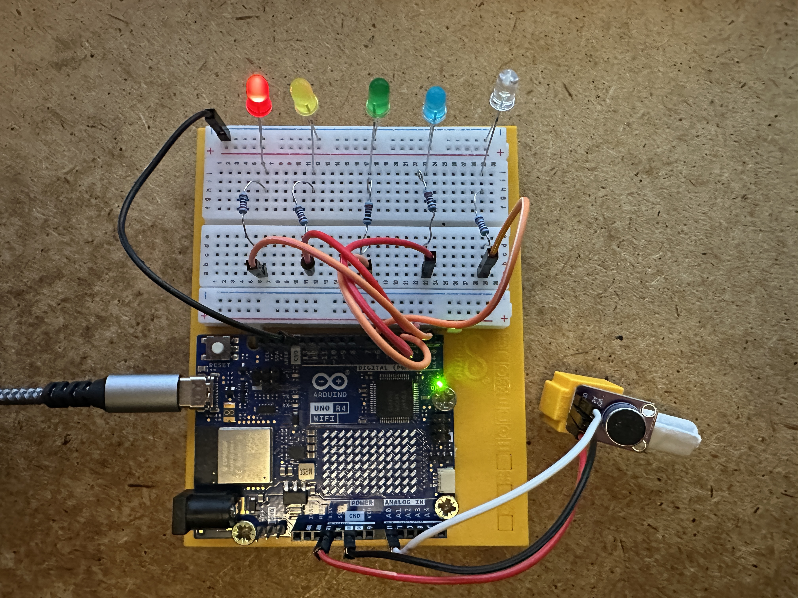

## [](https://github.com/ARPOISE/ARDUINO/) VoiceCommandsWithMax4466Microphone

An ARDUINO sketch for processing six simple voice commands switching LEDs on and off.
The sketch uses a simple voice recognition implementation running directly on the ARDUINO.
The voice recognition software initially needs to be trained by the user with spoken command words.
The training data is then stored on the ARDUINO, so the sketch can be used without repeated training.

- The sketch uses six command words for turning on the five LEDs and for turning them all off.
- The command words to be used to turn on the LEDs have to be entered in a training session after the sketch is started for the first time.
- Each word for the five colors and the 'off' command has to be spoken five times. In my example I used the words "red", "yellow", "green", "blue", "white", and "off".
- After the training data has been entered, i.e. spoken into the microphone, the data is stored in the EEPROM of the ARDUINO.
- When the sketch starts and finds stored training data on the EEPROM, the data is loaded and no training session is started. Entering the message 't' in the Serial Monitor starts a new training session.
- When the sketch is not in training mode and one of the command words is recognized, the corresponding LED is turned on, and all others off.
- If the 'off' command is recognized, all LEDs are turned off.

This is a picture of the setup:



### Software:
- Standard ARDUINO software.

### Parts:

- ARDUINO UNO R4 WIFI and breadboard
- One Microphone Amplifier - MAX4466, https://www.adafruit.com/product/1063
- Five 220 Ohm resistors
- Five LEDs, I used the colors red, yellow, green, blue, and white
- Cables

### Wiring:
- The Microphone is connected to 3.3V, Ground, and the analog pin A0.
- The digital pins D2 to D6 are connected to one resistor each.
- Each resistor is connected to an LED. D2 - red, D3 - yellow, D4 - green, D5 - blue, D6 - white.
- The LEDs are connected to Ground.

### Code:
```text
/*
 VoiceCommandsWithMax4466Microphone.ino - ARDUINO sketch for 6 simple voice commands switching on LEDs.

MIT License

Copyright (C) 2026, Tamiko Thiel and Peter Graf

Permission is hereby granted, free of charge, to any person obtaining a copy
of this software and associated documentation files (the "Software"), to deal
in the Software without restriction, including without limitation the rights
to use, copy, modify, merge, publish, distribute, sublicense, and/or sell
copies of the Software, and to permit persons to whom the Software is
furnished to do so, subject to the following conditions:

The above copyright notice and this permission notice shall be included in all
copies or substantial portions of the Software.

THE SOFTWARE IS PROVIDED "AS IS", WITHOUT WARRANTY OF ANY KIND, EXPRESS OR
IMPLIED, INCLUDING BUT NOT LIMITED TO THE WARRANTIES OF MERCHANTABILITY,
FITNESS FOR A PARTICULAR PURPOSE AND NONINFRINGEMENT. IN NO EVENT SHALL THE
AUTHORS OR COPYRIGHT HOLDERS BE LIABLE FOR ANY CLAIM, DAMAGES OR OTHER
LIABILITY, WHETHER IN AN ACTION OF CONTRACT, TORT OR OTHERWISE, ARISING FROM,
OUT OF OR IN CONNECTION WITH THE SOFTWARE OR THE USE OR OTHER DEALINGS IN THE
SOFTWARE.

For more information on

Tamiko Thiel, see www.TamikoThiel.com/
Peter Graf, see www.mission-base.com/peter/

*/
#include <Arduino.h>
#include <math.h>
#include <EEPROM.h>

// ========================================================
// VOICE-CONTROLLED COLOR LEDS
// Arduino Uno R4 WiFi + MAX4466 microphone
//
// Microphone: OUT=A0, VCC=3.3V, GND=GND
// LEDs (each with a 220-ohm resistor):
//   RED=D2, YELLOW=D3, GREEN=D4, BLUE=D5, WHITE=D6
//
// Commands: RED, YELLOW, GREEN, BLUE, WHITE, OFF
// Exactly one LED is on at a time; OFF turns all off.
// UNKNOWN does not change the LEDs.
//
// Serial Monitor: 115200 baud, Newline
//   r = arm the next training example
//   t = retrain all six commands
// Five examples per command. Completed training is stored as
// averaged 32-bit spectral templates in EEPROM-compatible storage.
// Valid saved templates load automatically on restart.
// ========================================================

// --------------------------------------------------------
// Hardware and audio configuration
// --------------------------------------------------------
const byte MIC_PIN = A0;
const byte LED_COUNT = 5;
const byte LED_PINS[LED_COUNT] = {2, 3, 4, 5, 6};
const byte WORD_COUNT = 6;
const byte TRAINING_EXAMPLES = 5;
const byte BAND_COUNT = 8;
const byte TIME_BINS = 8;
const byte FRAME_SAMPLES = 128;
const unsigned long SAMPLE_PERIOD_US = 125; // 8 kHz
const unsigned long CALIBRATION_MS = 3000;
const unsigned long SILENCE_END_MS = 180;
const unsigned long READY_QUIET_MS = 250;
const unsigned long MAX_EVENT_MS = 1400;
const byte MAX_FRAMES = 88; // 88 x 16 ms = 1408 ms
const byte MIN_FRAMES = 7;
// Goertzel analysis frequencies in Hz.
const float FREQUENCIES[BAND_COUNT] = {250, 400, 600, 850, 1150, 1550, 2100, 2850};
const char *WORD_NAMES[WORD_COUNT] = {"RED", "YELLOW", "GREEN", "BLUE", "WHITE", "OFF"};

// --------------------------------------------------------
// LED output
// --------------------------------------------------------
void setLedForCommand(byte command)
{
    for (byte i = 0; i < LED_COUNT; i++)
    {
        digitalWrite(LED_PINS[i], (command == i) ? HIGH : LOW);
    }
}

// --------------------------------------------------------
// Recognition and training state
// --------------------------------------------------------
// Each template is the average of five examples. Each word
// is represented by eight time regions x eight frequency bands.
// Word duration is reported but not used for classification.
float templates[WORD_COUNT][TIME_BINS][BAND_COUNT] = {};
float eventBands[MAX_FRAMES][BAND_COUNT];
float eventSignature[TIME_BINS][BAND_COUNT];
float goertzelCoefficients[BAND_COUNT];
int16_t samples[FRAME_SAMPLES];
byte trainingCounts[WORD_COUNT] = {};
byte trainingWord = 0;
byte frameCount = 0;
int startThreshold = 120;
int stopThreshold = 75;
int eventPeak = 0;
unsigned long eventStartMs = 0;
unsigned long lastLoudMs = 0;
unsigned long quietSinceMs = 0;
bool recording = false;
bool armed = false;
bool waitingForQuiet = false;
bool trained = false;

// --------------------------------------------------------
// Persistent training storage
// --------------------------------------------------------
// EEPROM layout is deliberately unchanged for compatibility
// with previously saved training:
//   bytes 0-3: magic number
//   byte 4: format version
//   byte 5: number of commands
//   bytes 6-7: checksum
//   bytes 8 onward: raw 32-bit float templates (1536 bytes)
// The checksum detects corruption; it is not a security check.
const uint32_t EEPROM_MAGIC = 0x3643564DUL;
const byte EEPROM_VERSION = 1;
const int EEPROM_HEADER_SIZE = 8;
const int EEPROM_TEMPLATE_BYTES = sizeof(templates);

uint16_t updateChecksum(uint16_t checksum, byte value)
{
    return (uint16_t)((checksum * 31U) + value);
}

bool loadTemplates()
{
    if (EEPROM.length() < EEPROM_HEADER_SIZE + EEPROM_TEMPLATE_BYTES)
    {
        Serial.println(F("ERROR: EEPROM capacity insufficient."));
        return false;
    }
    uint32_t magic = 0;
    for (byte i = 0; i < 4; i++)
    {
        magic |= ((uint32_t)EEPROM.read(i) << (8 * i));
    }
    if (magic != EEPROM_MAGIC || EEPROM.read(4) != EEPROM_VERSION ||
        EEPROM.read(5) != WORD_COUNT)
    {
        return false;
    }
    uint16_t expected = (uint16_t)EEPROM.read(6) |
                        ((uint16_t)EEPROM.read(7) << 8);
    uint16_t checksum = 0;
    byte *destination = (byte *)templates;
    for (int i = 0; i < EEPROM_TEMPLATE_BYTES; i++)
    {
        byte value = EEPROM.read(EEPROM_HEADER_SIZE + i);
        destination[i] = value;
        checksum = updateChecksum(checksum, value);
    }
    if (checksum != expected)
    {
        Serial.println(F("Saved templates failed checksum verification."));
        return false;
    }
    for (byte w = 0; w < WORD_COUNT; w++)
    {
        trainingCounts[w] = TRAINING_EXAMPLES;
    }
    trainingWord = WORD_COUNT;
    trained = true;
    return true;
}

void saveTemplates()
{
    if (EEPROM.length() < EEPROM_HEADER_SIZE + EEPROM_TEMPLATE_BYTES)
    {
        Serial.println(F("ERROR: EEPROM capacity insufficient; not saved."));
        return;
    }
    // Invalidate the header first. Commit the magic number last
    // so interrupted writes are not accepted as complete.
    EEPROM.update(0, 0);
    const byte *source = (const byte *)templates;
    uint16_t checksum = 0;
    for (int i = 0; i < EEPROM_TEMPLATE_BYTES; i++)
    {
        EEPROM.update(EEPROM_HEADER_SIZE + i, source[i]);
        checksum = updateChecksum(checksum, source[i]);
    }
    EEPROM.update(4, EEPROM_VERSION);
    EEPROM.update(5, WORD_COUNT);
    EEPROM.update(6, (byte)(checksum & 0xFF));
    EEPROM.update(7, (byte)(checksum >> 8));
    for (byte i = 1; i < 4; i++)
    {
        EEPROM.update(i, (byte)(EEPROM_MAGIC >> (8 * i)));
    }
    EEPROM.update(0, (byte)EEPROM_MAGIC);
    Serial.println(F("TRAINING SAVED: 32-bit float templates."));
}

// Forward declaration: used when retraining is requested.
void printTrainingPrompt();

void resetTraining()
{
    trained = false;
    trainingWord = 0;
    for (byte w = 0; w < WORD_COUNT; w++)
    {
        trainingCounts[w] = 0;
    }
    armed = false;
    recording = false;
    waitingForQuiet = false;
    frameCount = 0;
    Serial.println(F("RETRAINING: send r for each new example."));
    printTrainingPrompt();
}

unsigned long lastReadyPrintMs = 0;

// --------------------------------------------------------
// Audio capture and spectral features
// --------------------------------------------------------
void prepareGoertzel()
{
    for (byte b = 0; b < BAND_COUNT; b++)
    {
        goertzelCoefficients[b] = 2.0f * cosf(2.0f * PI * FREQUENCIES[b] / 8000.0f);
    }
}

// Samples one 16 ms frame at approximately 8 kHz.
// Centering each frame removes the microphone's DC bias.
int captureFrame()
{
    uint32_t total = 0;
    int minimum = 4095;
    int maximum = 0;
    unsigned long nextSample = micros();
    for (byte i = 0; i < FRAME_SAMPLES; i++)
    {
        while ((long)(micros() - nextSample) < 0)
        {
        }
        int value = analogRead(MIC_PIN);
        samples[i] = value;
        total += value;
        if (value < minimum)
        {
            minimum = value;
        }
        if (value > maximum)
        {
            maximum = value;
        }
        nextSample += SAMPLE_PERIOD_US;
    }
    int mean = (int)(total / FRAME_SAMPLES);
    for (byte i = 0; i < FRAME_SAMPLES; i++)
    {
        samples[i] -= mean;
    }
    return maximum - minimum;
}

void calculateBands(float *out)
{
    float total = 0.0f;
    for (byte b = 0; b < BAND_COUNT; b++)
    {
        float q1 = 0.0f;
        float q2 = 0.0f;
        float coefficient = goertzelCoefficients[b];
        for (byte i = 0; i < FRAME_SAMPLES; i++)
        {
            // Hann window reduces spectral leakage.
            float window = 0.5f - 0.5f * cosf(2.0f * PI * i / (FRAME_SAMPLES - 1));
            float q0 = coefficient * q1 - q2 + samples[i] * window;
            q2 = q1;
            q1 = q0;
        }
        float power = q1 * q1 + q2 * q2 - coefficient * q1 * q2;
        out[b] = sqrtf(fmaxf(0.0f, power));
        total += out[b];
    }
    if (total > 0.001f)
    {
        for (byte b = 0; b < BAND_COUNT; b++)
        {
            out[b] /= total;
        }
    }
}

void makeSignature()
{
    // Resample the recorded frames into eight equal time regions.
    // Retain the normalized spectrum for each region.
    for (byte t = 0; t < TIME_BINS; t++)
    {
        for (byte b = 0; b < BAND_COUNT; b++)
        {
            eventSignature[t][b] = 0.0f;
        }
        int beginIndex = (int)t * frameCount / TIME_BINS;
        int endIndex = (int)(t + 1) * frameCount / TIME_BINS;
        if (endIndex <= beginIndex)
        {
            endIndex = beginIndex + 1;
        }
        if (endIndex > frameCount)
        {
            endIndex = frameCount;
        }
        for (int f = beginIndex; f < endIndex; f++)
        {
            for (byte b = 0; b < BAND_COUNT; b++)
            {
                eventSignature[t][b] += eventBands[f][b];
            }
        }
        float divisor = endIndex - beginIndex;
        for (byte b = 0; b < BAND_COUNT; b++)
        {
            eventSignature[t][b] /= divisor;
        }
    }
}

float distanceToWord(byte word)
{
    float sum = 0.0f;
    for (byte t = 0; t < TIME_BINS; t++)
    {
        for (byte b = 0; b < BAND_COUNT; b++)
        {
            sum += fabsf(eventSignature[t][b] - templates[word][t][b]);
        }
    }
    return sum / TIME_BINS; // Typical scale 0 to 2.
}

// --------------------------------------------------------
// Training and recognition
// --------------------------------------------------------
void printTrainingPrompt()
{
    if (trainingWord >= WORD_COUNT)
    {
        trained = true;
        saveTemplates();
        Serial.println(F("TRAINING COMPLETE. Say RED, YELLOW, GREEN, BLUE, WHITE or OFF."));
        return;
    }
    Serial.print(F("TRAIN "));
    Serial.print(WORD_NAMES[trainingWord]);
    Serial.print(' ');
    Serial.print(trainingCounts[trainingWord] + 1);
    Serial.println(F("/5: send r, wait for READY, then speak once."));
}

void processEvent()
{
    if (frameCount < MIN_FRAMES)
    {
        Serial.println(F("IGNORED: event too short"));
        return;
    }
    makeSignature();
    unsigned long duration = (unsigned long)frameCount * 16UL;
    Serial.print(F("EVENT Frames="));
    Serial.print(frameCount);
    Serial.print(F(" DurationMs~"));
    Serial.print(duration);
    Serial.print(F(" Peak="));
    Serial.print(eventPeak);
    if (!trained)
    {
        byte n = trainingCounts[trainingWord];
        for (byte t = 0; t < TIME_BINS; t++)
        {
            for (byte b = 0; b < BAND_COUNT; b++)
            {
                templates[trainingWord][t][b] =
                    (templates[trainingWord][t][b] * n + eventSignature[t][b]) / (n + 1);
            }
        }
        trainingCounts[trainingWord]++;
        Serial.print(F(" TRAINED "));
        Serial.print(WORD_NAMES[trainingWord]);
        Serial.print(' ');
        Serial.print(trainingCounts[trainingWord]);
        Serial.println(F("/5"));
        if (trainingCounts[trainingWord] == TRAINING_EXAMPLES)
        {
            trainingWord++;
        }
        printTrainingPrompt();
    }
    else
    {
        float distances[WORD_COUNT];
        byte bestWord = 0;
        byte secondWord = 1;
        for (byte w = 0; w < WORD_COUNT; w++)
        {
            distances[w] = distanceToWord(w);
            if (distances[w] < distances[bestWord])
            {
                bestWord = w;
            }
        }
        secondWord = bestWord == 0 ? 1 : 0;
        for (byte w = 0; w < WORD_COUNT; w++)
        {
            if (w != bestWord && distances[w] < distances[secondWord])
            {
                secondWord = w;
            }
        }
        // Accept only a sufficiently close and unambiguous match.
        // Keep these tested thresholds unchanged.
        const char *result = "UNKNOWN";
        if (distances[bestWord] < 0.65f &&
            distances[secondWord] - distances[bestWord] > 0.06f)
        {
            result = WORD_NAMES[bestWord];
            setLedForCommand(bestWord);
        }
        Serial.print(' ');
        Serial.print(result);
        Serial.print(F(" Spectral RED="));
        Serial.print(distances[0], 3);
        Serial.print(F(" YELLOW="));
        Serial.print(distances[1], 3);
        Serial.print(F(" GREEN="));
        Serial.print(distances[2], 3);
        Serial.print(F(" BLUE="));
        Serial.print(distances[3], 3);
        Serial.print(F(" WHITE="));
        Serial.print(distances[4], 3);
        Serial.print(F(" OFF="));
        Serial.println(distances[5], 3);
    }
}

// --------------------------------------------------------
// Startup noise calibration
// --------------------------------------------------------
void calibrate()
{
    Serial.println(F("CALIBRATING: stay silent for 3 seconds."));
    const byte BUCKETS = 50;
    uint16_t values[BUCKETS] = {};
    byte count = 0;
    unsigned long start = millis();
    while (millis() - start < CALIBRATION_MS)
    {
        int amplitude = captureFrame();
        if (count < BUCKETS)
        {
            values[count++] = amplitude;
        }
        else
        {
            values[(millis() / 16) % BUCKETS] = amplitude;
        }
    }
    for (byte i = 1; i < count; i++)
    {
        uint16_t value = values[i];
        int j = i - 1;
        while (j >= 0 && values[j] > value)
        {
            values[j + 1] = values[j];
            j--;
        }
        values[j + 1] = value;
    }
    int p95 = values[(count - 1) * 95 / 100];
    startThreshold = max(100, (int)(p95 * 2.3f));
    stopThreshold = max(65, (int)(p95 * 1.5f));
    Serial.print(F("Noise P95="));
    Serial.print(p95);
    Serial.print(F(" START="));
    Serial.print(startThreshold);
    Serial.print(F(" STOP="));
    Serial.println(stopThreshold);
}

// --------------------------------------------------------
// Arduino setup and main loop
// --------------------------------------------------------
void setup()
{
    for (byte i = 0; i < LED_COUNT; i++)
    {
        pinMode(LED_PINS[i], OUTPUT);
    }
    setLedForCommand(WORD_COUNT - 1); // All LEDs off at startup.
    Serial.begin(115200);
    analogReadResolution(12);
    delay(800);
    prepareGoertzel();
    Serial.println(F("MAX4466 SPECTRAL TRAINER - SIX COMMANDS"));
    calibrate();
    if (loadTemplates())
    {
        Serial.println(F("SAVED TRAINING LOADED. Say RED, YELLOW, GREEN, BLUE, WHITE or OFF."));
        Serial.println(F("Send t to retrain."));
    }
    else
    {
        Serial.println(F("NO SAVED TRAINING. Train RED, YELLOW, GREEN, BLUE, WHITE, OFF."));
        printTrainingPrompt();
    }
}

void loop()
{
    while (Serial.available() > 0)
    {
        char c = Serial.read();
        if (c == 't' || c == 'T')
        {
            resetTraining();
        }
        else if (!trained && (c == 'r' || c == 'R'))
        {
            armed = true;
            waitingForQuiet = true;
            quietSinceMs = 0;
            Serial.println(F("ARMED: waiting for quiet."));
        }
    }
    int amplitude = captureFrame();
    unsigned long now = millis();
    if (!trained && !armed)
    {
        return;
    }
    if (waitingForQuiet)
    {
        if (amplitude < stopThreshold)
        {
            if (quietSinceMs == 0)
            {
                quietSinceMs = now;
            }
            if (now - quietSinceMs >= READY_QUIET_MS)
            {
                waitingForQuiet = false;
                Serial.println(F("READY: speak once now."));
            }
        }
        else
        {
            quietSinceMs = 0;
        }
        return;
    }
    if (!recording)
    {
        if (amplitude >= startThreshold)
        {
            recording = true;
            frameCount = 0;
            eventPeak = 0;
            eventStartMs = now;
            lastLoudMs = now;
        }
        else
        {
            if (now - lastReadyPrintMs >= 1000)
            {
                lastReadyPrintMs = now;
                Serial.print(F("READY Amp="));
                Serial.print(amplitude);
                Serial.print(F(" Start="));
                Serial.println(startThreshold);
            }
            return;
        }
    }
    if (frameCount < MAX_FRAMES)
    {
        calculateBands(eventBands[frameCount]);
        frameCount++;
    }
    if (amplitude > eventPeak)
    {
        eventPeak = amplitude;
    }
    if (amplitude >= stopThreshold)
    {
        lastLoudMs = now;
    }
    if (now - lastLoudMs >= SILENCE_END_MS || now - eventStartMs >= MAX_EVENT_MS || frameCount >= MAX_FRAMES)
    {
        recording = false;
        if (!trained)
        {
            armed = false;
        }
        processEvent();
        // Require a short quiet gap before the next word.
        waitingForQuiet = true;
        quietSinceMs = 0;
    }
}
```

